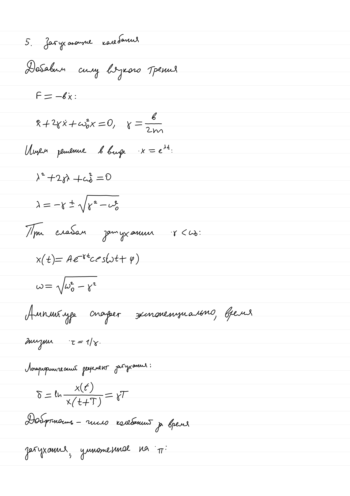
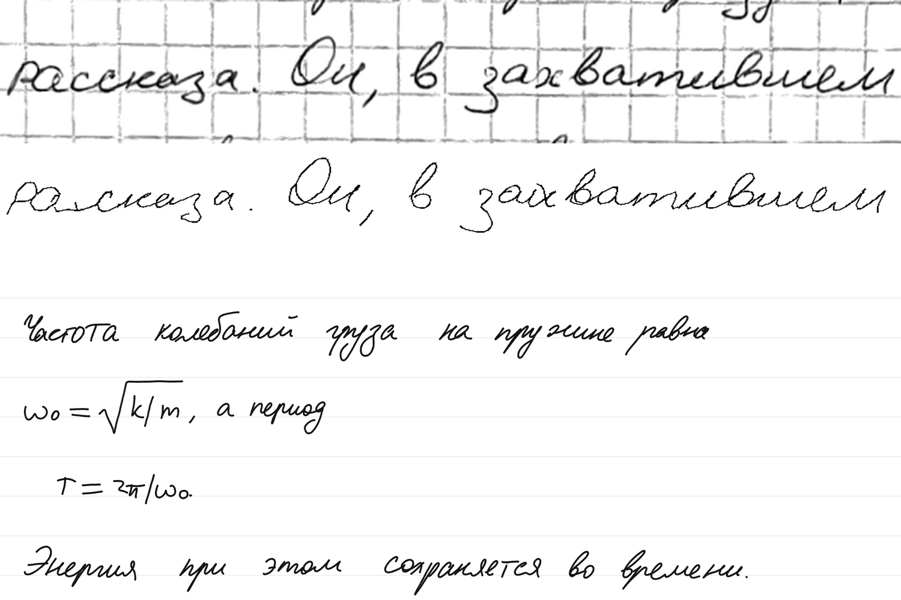

# Scrawler

Turns a text file with LaTeX formulas into handwritten notebook pages. The style comes from **one line** of the writer's handwriting, with no fine-tuning.



*The page above is in the author's hand, written by personal fine-tuned models that are **not** released. For what the released weights give out of the box, see [this page](examples/demo_released_weights/page_05.png).*

The output is pen strokes, not pixels, so the PDF is sharp at any zoom. The models write Russian prose and mathematics.

This repository holds the code for writing pages. The weights are on [Hugging Face](https://huggingface.co/levossadtchi/Scrawler-open). Training code and data are not included.

## Quick start

Requires Python and, for formulas, Node.js.

```bash
git clone https://github.com/Levos06/Scrawler-open.git
cd Scrawler-open
pip install -r requirements.txt
(cd tools/mathjax && npm ci)
python download_weights.py
python write_pages.py examples/physics_oscillator.txt out
```

This writes to `out/` (the folder must not exist yet):

- `pages.pdf`: vector, every stroke a smooth curve
- `page_NN.svg` and `page_NN.png` (300 dpi)
- `strokes.json`: the strokes; `python render_pages.py out/strokes.json thick --pen 1.4` redraws them without the models
- `report.json`: per-line timing and what wrote each glyph

The code selects CUDA, MPS or CPU by itself; set `SCRAWLER_DEVICE` to force one. Results depend on the device: the same seed gives the same pages only on the same device. Tested on Apple Silicon (MPS and CPU); the CUDA path has not been run with this code.

The example above is 11 pages and took under 7 minutes on an Apple M5 Max (MPS). The CPU is much slower: a 4-page test with many formulas took 74 minutes.

## Writing in your own hand

You need one line of your handwriting: 30-50 characters of ordinary prose. There are two ways to get it into the models.

### From a photo or scan

Crop the photo to **one line** and run it through the [tracer](trace/README.md), which recovers the pen strokes from the image.

```bash
python download_weights.py --tracer
pip install -r trace/requirements.txt
python trace/scrawler_trace.py my_line.png --out my_line.json
python make_ref.py my_line.json my_line.npy
python write_pages.py notes.txt out --ref my_line.npy
```

For a good result:

- Crop tightly to one line. Parts of the lines above and below can get into the trace.
- Use dark pen on light paper. Colour photos, dark backgrounds and low contrast work poorly.
- Look at the trace before using it: add `--svg my_line.svg` to the tracer command to see the strokes.



*Top: a real scan on squared paper (HWR200, open data). Middle: the trace. Bottom: new text and formulas in that style. One example, not a measurement.*

The tracer weights have their own licence caveat, see [its training data](trace/TRAINING_DATA.md).

### From a tablet

If the line was written in a note app, its pen strokes are in the app's file and no tracer is needed. `tablet/app_line.py` reads GoodNotes, Notewise, Huawei Notes, Kilonotes and Samsung Notes. The recipe for each app, and for the apps that are not read, is in [tablet/README.md](tablet/README.md).

```bash
python tablet/app_line.py notes.goodnotes my_line.json --page 3 --line 2 --svg check.svg
python make_ref.py my_line.json my_line.npy
python write_pages.py notes.txt out --ref my_line.npy
```

If you have the strokes from somewhere else, write them as a JSON list of strokes, each a list of `[x, y]` points with y pointing down, in writing order: that is what `make_ref.py` takes.

The default style is one traced line of the open HWR200 dataset.

## Input format

```text
# A heading
A line of text with an inline formula $\omega_0 = \sqrt{k/m}$ in it.
$x(t) = A\cos(\omega_0 t + \varphi)$

An empty line above makes a paragraph gap.
```

Long lines are wrapped at about 42 characters (`--wrap`), never inside `$...$`. Formulas use the LaTeX that MathJax understands. `python write_pages.py --help` lists the other options.

## How it works

| On the line | Written by |
|---|---|
| text only | **Text model**: a diffusion denoiser over pen points, with a duration planner for each character |
| formula only | **Formula module**: MathJax places every glyph, a diffusion **glyph model** draws each one, and a classifier picks the most recognisable variant |
| text + `$formula$` | The text model writes the line, then the formula spans are replaced by the formula module |

The style vector comes from a line-level writer encoder. Fraction bars, radicals, arrows and `|x|` are drawn as pen lines by code, not by a model, so they do not take the writer's style.

| Path | What |
|---|---|
| `write_pages.py` | text file -> pages: wrapping, page layout, the order of the steps |
| `write_line.py` | one line of text in the hand of a reference line, the way the site does it |
| `scrawler/text_model.py` | text model and duration planner |
| `scrawler/site_model.py` | the site's text model, recogniser, writer classifier and the choice of the best attempt |
| `scrawler/style_encoder.py` | one line -> style vector |
| `scrawler/glyph_model.py` | glyph model and the classifier that picks variants |
| `scrawler/formula.py` | formula layout, pen-line marks, inserting formulas into text |
| `scrawler/render.py`, `render_pages.py` | strokes -> PDF, SVG, PNG |
| `make_ref.py` | your strokes -> a style line |
| `trace/` | the tracer, one file |
| `tablet/` | a line out of a note app: readers of GoodNotes, Notewise, Huawei Notes, Kilonotes and Samsung Notes files |
| `tools/mathjax/layout.mjs` | LaTeX -> glyph boxes |
| `data/glyph_stroke_counts.json` | per glyph class, how many real glyphs had 1, 2, ... strokes; counts only |

## The model on the site

[synthink.dev](https://synthink.dev) writes a line in your handwriting right in the browser: [try it there](https://synthink.dev/generate/). Every model the site runs is in this release, and `write_line.py` does the same on your machine: one line of your handwriting from a photo or a tablet goes in, a new line in that hand comes out.

```bash
python download_weights.py --site --tracer
pip install -r trace/requirements.txt
python trace/scrawler_trace.py my_line.png --out my_line.json --svg my_line.svg   # photo of one line -> pen strokes
python make_ref.py my_line.json my_line.npy                                         # pen strokes -> reference line
python write_line.py "Мороз и солнце; день чудесный!" out_line --ref my_line.npy --ref-text "what your line says"
```

For a line from a tablet, the tracer step is replaced by `tablet/app_line.py`, see [tablet/README.md](tablet/README.md).

`out_line/` gets `line.svg`, `line.png` and `line.pdf` with the chosen attempt, `attempts.png` with all four, and `strokes.json`. The first argument can also be a `.txt` file with one line of text per row. Formulas are not written here. A line takes about 9 seconds on an Apple M5 Max (MPS).

| On the site | Here | What it does |
|---|---|---|
| `den.onnx`, `refpts.onnx` | `ckpt_dl/u3ref/fp16/step060000_fp16.pt` | text model that also attends to the pen points of the reference line |
| `planner.onnx` | `ckpt_dl/planner7/best.pt` | pen points per character |
| `semb.onnx` | `ckpt_semb3_all/best.pt` | style vector of the reference line |
| `rec.onnx` | `ckpt_ctc4/ctc_fp16.pt` | recogniser: how legible an attempt is |
| `scls.onnx` | `ckpt_stylecls/embed_fp16.pt` | writer classifier without its class layer: how close an attempt is to the reference |
| `fix.onnx`, `tenc.onnx`, `tstep.onnx` | `trace/weights/` | ink restorer and tracer, for the photo route |

The weights are on [Hugging Face](https://huggingface.co/levossadtchi/Scrawler-open) and `download_weights.py --site` fetches them; the site runs the same weights converted to ONNX.

The recipe, in `scrawler/site_model.py`:

1. The planner gives the number of pen points for every character. These are multiplied by the writer's spread: the length of the reference line in points over the length the planner gives for the text of that line, clipped to [0.6, 1.4]. This is why `--ref-text` is asked for. Without it the recogniser reads the reference, which gets most letters right but not all.
2. The text model writes the line four times, with guidance 1.5 and 20 steps.
3. The recogniser keeps the attempts whose character error rate is within 0.02 of the lowest, and of those the writer classifier picks the one closest to the reference.

The code was checked against the ONNX files the site serves: from the same noise the pen points agree to 0.0003 of the line height and the same attempt is chosen.

The text model is the text model of this release trained for 60 000 more steps, with two additions: traced lines of 190 HWR200 writers in the training data, and attention from every generated point to the pen points of the reference line. The model reads the reference line itself, not only its style vector.

Measured on traced lines of 9 writers the model never saw: the cosine of a writer classifier between a generated line and the writer's own line is 0.71, against 0.47 for the release text model; to other writers it is 0.46 for both. Legibility did not change: 47.1% clean lines on the set of the table below, the same as "Text model alone". By eye the gain in likeness is modest.

`write_pages.py` does not use the site model: pages and formulas are written by the text model that plain `download_weights.py` fetches.

## Evaluation

240 lines of real notes from writers the generator never saw, each written from one reference line by the same writer. An LLM judge (Gemini 4 Argon) lists errors in each line; "clean" means no error of severity 2 or higher. Pairs are re-sampled for the 95% intervals.

| Run | Clean, % [95%] | Prose | Mixed | Formula |
|---|---|---|---|---|
| Real handwriting of the same lines | 45.0 [38.8, 51.2] | 47.0 | 35.7 | 51.4 |
| Text model alone | 47.1 [40.8, 53.3] | 63.0 | 41.4 | 30.0 |
| **This release** | **61.3 [55.0, 67.5]** | 63.0 | 54.3 | 65.7 |
| Same, with a library of real glyphs (not released) | 65.4 [59.2, 71.2] | 62.0 | 58.6 | 77.1 |

How to read this table:

- The score rewards legibility. Scoring above real notes means the output is tidier than hurried human writing, not that it looks more human.
- Prose is the same set of generated lines in every run but the first, so 62-63 shows judge noise of a few points.
- The private library variant scores 4.2 points higher, 95% interval [-9.6, +1.2] for the difference. That is within the noise, but a small loss from removing it is possible.

Style similarity by the writer encoder (cosine to the writer's real line, one reference line, 3 unseen writers): 0.59-0.68 generated, against 0.55-0.70 between real lines of the same writers.

## Known weaknesses

- The text model sometimes swaps, drops or adds a letter. There is no spell check.
- The site model (`write_line.py`) often adds a stray stroke to the first word of a line, an underline or a strike-through: a stroke detector found one in the chosen attempt for 10 of 20 test hands.
- A one-letter formula inside a sentence can collide with the neighbouring word.
- About 2% of glyphs are the best of the variants the classifier rejected, and may be misshapen.
- Rare symbols without their own class are drawn as a similar one (for example `\simeq` as `\approx`).
- A heading of one short word may come out smaller than the other lines.
- A line of several formulas with almost no plain text between them is written by the text model alone instead of the formula module (`fallback_text_model` in `report.json`).

## Training data

- **Generator models:** tablet handwriting of 13 writers who agreed to this use, about 63 000 lines and 86 000 glyphs. Writer names are removed from the weights. The notes themselves are not published.
- **Text model of the site:** the same, plus traced lines of 190 writers of [HWR200](https://huggingface.co/datasets/AntiplagiatCompany/HWR200) (Apache-2.0).
- **Recogniser:** the tablet lines above, the same lines rendered to images and traced back, and traced lines of HWR200.
- **Writer classifier:** tablet lines of 15 writers: 12 of the 13 above and three more.
- **Style encoder:** the same kind of tablet data, plus traced lines of [HWR200](https://huggingface.co/datasets/AntiplagiatCompany/HWR200) (Apache-2.0).
- **Tracer:** a mix of tablet notes and open sets, some with non-commercial or ShareAlike terms. See [trace/TRAINING_DATA.md](trace/TRAINING_DATA.md), including the open question about ShareAlike.

## Responsible use

This is for notes, experiments and research. Do not use it to forge signatures, documents or exam work, or to imitate someone's handwriting without their consent.

## License

Code: Apache-2.0 ([LICENSE](LICENSE)). The weights are downloaded separately and are under CC BY-NC 4.0; the tracer weights carry further conditions from their training data, see [trace/TRAINING_DATA.md](trace/TRAINING_DATA.md). Third-party components: [NOTICE](NOTICE).
