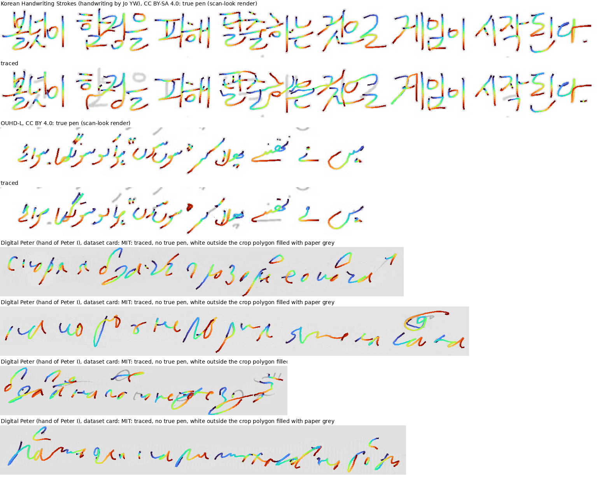

# Scrawler tracer

Image of one handwritten line -> pen trajectory: points, pen lifts, pressure.



*Colour runs along the pen path. The bottom four lines are the hand of Peter I, where garbage is visible too. This image includes a render of Korean Handwriting Strokes and so is under CC BY-SA 4.0.*

**Licence caveat: read [TRAINING_DATA.md](TRAINING_DATA.md) before using the weights.**

## Files

| file | what | size |
|---|---|---|
| `scrawler_trace.py` | the whole inference, one file, no training imports | 36 KB |
| `weights/trace8_fp16.pt` (on Hugging Face) | tracer: CNN + 2-layer transformer encoder, autoregressive 6-layer decoder, 23.4M parameters | 46.8 MB |
| `weights/inkfix1.pt` (on Hugging Face) | ink restorer: U-Net, 7.5M parameters | 15.0 MB |
| `requirements.txt` | torch, numpy, pillow, opencv-python | |
| `TRAINING_DATA.md` | training data, its terms and the open ShareAlike question | |
| `example_open_lines.png` | example on open data only | |

Both weight files load with `torch.load(..., weights_only=True)`. They hold only the keys `e` (weights), `step`, `cfg`.

## Run

```bash
python download_weights.py --tracer   # from the repository root: the weights go to trace/weights/
cd trace
pip install -r requirements.txt
python scrawler_trace.py line.png --out trace.json --svg trace.svg --seed 0
```

```python
from scrawler_trace import Tracer
r = Tracer('weights').trace_image(gray_uint8_array, seed=0)
# r['px'] (n, 2) crop pixels; r['pen'] (n,) 1 = pen lifts after this point; r['pres'] (n,) pressure 0..1
```

Input is a crop of ONE line, any size. Page segmentation is not included. The tracer samples, so a different seed gives a slightly different trace. On a Mac the benchmark ran at about 3 lines/s in the batched research script; this single-line runner is slower, its speed was not measured separately.

## Recipe

Restored frame, rule removal, islands (with the long-thin rule off), tracer per island, guard, second pass over untraced own ink, stroke merge. Removing neighbour-line ink is optional and off by default (`--erase_neighbours`).

## Quality

Benchmark: 2677 lines of true pen the tracer never saw in training (English 600, Korean 297, MathWriting 500, Russian tablet prose 830 and math 300, Urdu 150), each rendered in three looks. F1 at R = 2 px on a 64 px frame.

| recipe | clean | scan | photo | strokes / true (median) | direction | order (Kendall) |
|---|---|---|---|---|---|---|
| **released (second pass, no erase)** | **0.960** | **0.945** | **0.943** | 1.00 / 1.00 / 1.00 | 0.856 / 0.844 / 0.848 | 0.823 / 0.820 / 0.818 |
| previous recipe | 0.954 | 0.938 | 0.935 | 0.96 / 0.95 / 0.95 | 0.860 / 0.850 / 0.854 | 0.837 / 0.838 / 0.839 |
| with `--erase_neighbours` | 0.941 | 0.931 | 0.933 | 0.95 / 0.95 / 1.00 | 0.857 / 0.847 / 0.852 | 0.835 / 0.828 / 0.827 |

The order column is pulled down by Urdu, written right to left: its strokes are traced in reverse (order about -0.85, direction about 0.55); the second pass costs 0.01-0.02 of order overall (Korean 0.986 -> 0.913 on clean). Do not rely on stroke order where it matters.

Against Google InkSight (older comparison, 27.10, previous recipe, InkSight's own protocol): geometry on HierText 0.655 vs 0.645 (Small-i); readable lines, exact match, are worse: HierText 47/100 vs 69, IAM 19/34 vs 23, IMGUR5K 36/93 vs 45. This model is narrow: it is at its best on handwriting close to its training mix and loses on colour photos, dark backgrounds and low contrast.

Per source: `BENCH_part_A.md`.

## From a photo of your line to your style

```bash
python trace/scrawler_trace.py my_line.png --out my_line.json
python make_ref.py my_line.json my_line.npy
python write_pages.py notes.txt out --ref my_line.npy
```

## Limits

- One line at a time.
- Stroke order of the second-pass strokes is not the writing order.
- Colour photos and dark or low-contrast backgrounds: weak, see InkSight above.
- Picks up parts of the neighbouring lines on tight crops (about 30% of lines in our HWR200 sample). `--erase_neighbours` removes that but also deletes own ink of formulas and of crops holding two lines.
- Crops cut out as a polygon on pure white: fill the white with the paper grey first, otherwise it traces the polygon edge.
- Latin and Cyrillic pen handwriting are the best covered; other scripts come mostly from fonts and small sets.
- Non-commercial, see [TRAINING_DATA.md](TRAINING_DATA.md).
